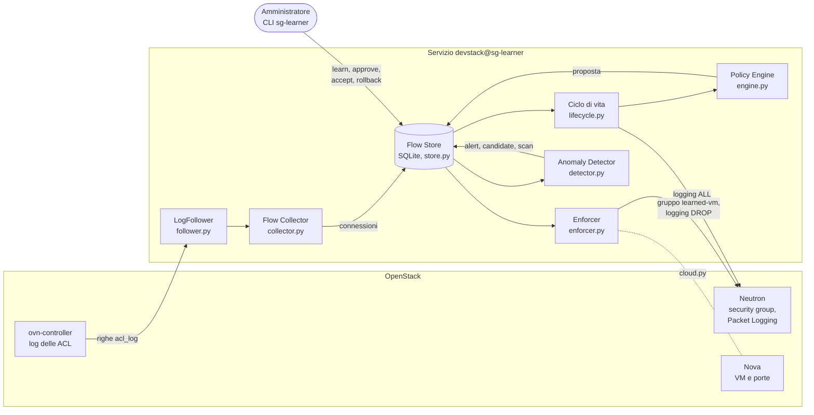

# SG-Learner

**Security group a minimo privilegio appresi dal traffico reale in OpenStack**

SG-Learner è un plugin DevStack che osserva il traffico reale delle VM di
OpenStack e propone, per ciascuna, il security group minimo che lo consente.
Dopo l'approvazione dell'amministratore applica il nuovo gruppo al posto di
quello originale e, da quel momento, segnala il traffico bloccato come
anomalia.

Nei cloud reali i security group nascono spesso troppo permissivi ("apri
tutto, poi si vedrà") e nessuno li restringe più, perché non è chiaro quali
porte servano davvero. SG-Learner ricava questa informazione dai log di rete,
ossia da ciò che le VM fanno davvero, e lascia all'amministratore solo la
decisione finale. In una demo con tre VM partite con un gruppo aperto, il
gruppo appreso lascia passare tutto il traffico dell'applicazione e blocca il
resto, compreso il movimento laterale da una VM compromessa verso il database.

---

## Indice

1. [Come funziona](#1-come-funziona)
2. [Requisiti](#2-requisiti)
3. [Installazione](#3-installazione)
4. [Uso](#4-uso)
5. [Configurazione](#5-configurazione)
6. [Demo con tre VM](#6-demo-con-tre-vm)
7. [Scelte di sicurezza](#7-scelte-di-sicurezza)
8. [Limiti noti](#8-limiti-noti)
9. [Struttura della repo e test](#9-struttura-della-repo-e-test)
10. [Autore e corso](#10-autore-e-corso)

---

## 1. Come funziona



Ogni VM seguita da SG-Learner attraversa quattro stati:

| Stato | Cosa succede | Come si passa allo stato successivo |
|---|---|---|
| `learning` | Il Packet Logging di Neutron registra **tutto** il traffico dei security group della VM; SG-Learner salva le connessioni | alla scadenza della finestra di osservazione, oppure con `proposal generate` |
| `proposed` | Il Policy Engine ha calcolato il gruppo minimo; la proposta attende l'amministratore | `proposal approve` |
| `approved` | La proposta è approvata | l'Enforcer la applica entro 30 secondi |
| `enforcing` | La VM usa il gruppo `learned-<vm>`; il logging registra solo il traffico **bloccato**, analizzato dall'Anomaly Detector | `rollback` riporta in `proposed`; un'anomalia accettata riporta in `approved` |

I componenti:

- **LogFollower** legge in continuo il log di `ovn-controller`, come `tail -f`.
  Riprende dal punto giusto dopo un riavvio e regge la rotazione del log.
- **Flow Collector** trasforma le righe `acl_log` (una per pacchetto) in
  connessioni: riconosce l'inizio di una connessione (SYN, echo request,
  datagramma UDP) e scarta le ritrasmissioni.
- **Flow Store** salva le connessioni in SQLite, aggregate per VM, direzione,
  protocollo, porta di servizio, altro capo e verdetto, insieme allo stato
  delle VM e alle anomalie.
- **Policy Engine** calcola la proposta: solo il traffico consentito diventa
  una regola; il traffico verso altre VM diventa una regola `remote_group`;
  se gli IP esterni distinti sono almeno 5 la regola usa `0.0.0.0/0`,
  altrimenti un `/32` per IP.
- **Enforcer** crea il gruppo `learned-<vm>`, ne allinea le regole alla
  proposta, lo assegna alla porta al posto dei gruppi originali e attiva il
  logging DROP. Ogni 30 secondi ricontrolla e corregge eventuali modifiche
  manuali.
- **Anomaly Detector** classifica il traffico bloccato delle VM applicate in
  `alert`, `candidate` o `scan` (vedi [Scelte di sicurezza](#7-scelte-di-sicurezza)).
- **CLI `sg-learner`** è l'interfaccia dell'amministratore; il servizio
  `devstack@sg-learner` fa tutto il resto.

---

## 2. Requisiti

- DevStack su **Ubuntu 24.04**, nodo singolo, con il backend di rete
  **ML2/OVN** (il default di DevStack). SG-Learner legge i log delle ACL di
  OVN, quindi non funziona con ML2/OVS o Linux bridge.
- Risorse consigliate per la macchina DevStack: **12 GB di RAM**, 6 vCPU,
  20 GB di disco (più 2 GB di swap).
- Il progetto è stato sviluppato e provato su una VM Ubuntu in VMware Fusion
  su Mac Apple Silicon. Senza virtualizzazione annidata Nova usa
  l'emulazione QEMU: servono la sezione ARM di `local.conf.sample` e il
  flavor `m1.tiny` per CirrOS.

---

## 3. Installazione

Nel file `local.conf` di DevStack basta una riga
(un esempio completo è in [`devstack/local.conf.sample`](devstack/local.conf.sample)):

```ini
[[local|localrc]]
enable_plugin sg-learner https://github.com/aselli-andrea/SG-Learner main
```

Poi, dalla cartella di DevStack:

```bash
./stack.sh
```

Il plugin ([`devstack/plugin.sh`](devstack/plugin.sh)) fa da solo tutto
quello che serve:

| Fase di DevStack | Cosa fa il plugin |
|---|---|
| `stack install` | installa il pacchetto Python `sg-learner` |
| `stack post-config` | attiva il Packet Logging di Neutron (service plugin `log`, `rate_limit` e `burst_limit`); crea l'utente di servizio `sg-learner` in Keystone; concede all'utente `stack` la lettura del log di OVN con una ACL; scrive `/etc/sg-learner/sg-learner.conf` |
| `stack extra` | avvia il servizio `devstack@sg-learner` (systemd) |
| `unstack` / `clean` | ferma il servizio / cancella configurazione e dati |

Per verificare l'installazione:

```bash
sudo systemctl status devstack@sg-learner
sudo journalctl -u devstack@sg-learner -n 20 --no-pager
```

Nel journal devono comparire l'autenticazione su Keystone, l'estensione
Logging API attiva e il log di OVN leggibile.

Dopo un riavvio della macchina DevStack conviene lanciare, come utente
`stack`, [`tools/post-boot.sh`](tools/post-boot.sh): aspetta la
sincronizzazione dell'orologio, ricollega `br-ex` e riavvia i servizi
nell'ordine giusto (1-3 minuti, da non interrompere).

---

## 4. Uso

Il comando `sg-learner` usa le credenziali dell'amministratore:

```bash
source /opt/stack/devstack/openrc admin admin
```

| Comando | Effetto |
|---|---|
| `sg-learner learn <vm> --duration 30m` | avvia l'osservazione della VM (attiva il logging sui suoi security group) |
| `sg-learner status` | stato di tutte le VM seguite |
| `sg-learner proposal generate <vm>` | chiude subito l'osservazione e calcola la proposta |
| `sg-learner proposal show <vm>` | mostra la proposta |
| `sg-learner proposal approve <vm>` | approva: l'Enforcer la applica entro 30 secondi |
| `sg-learner alerts list [<vm>] [--all]` | anomalie aperte (con `--all` anche quelle chiuse) |
| `sg-learner alerts accept <id>` | trasforma un'anomalia in regola (non vale per le scansioni) |
| `sg-learner alerts dismiss <id>` | chiude un'anomalia, che resta nello storico |
| `sg-learner rollback <vm>` | rimette i security group originali |

Esempio reale, la proposta per il web server della demo:

```
$ sg-learner proposal show vm-web
Proposta per vm-web (10.0.0.11) (16 connessioni osservate)
  = regole di base, sempre presenti: egress udp/67 verso 0.0.0.0/0, egress tcp/80 verso 169.254.169.254/32
  + ingress tcp/22 da 172.24.4.1/32                    1 conn.  [poco osservata]
  + ingress tcp/80 da 0.0.0.0/0                        5 conn.
  + ingress tcp/80 da gruppo vm:vm-app                 5 conn.
  + egress tcp/5432 verso gruppo vm:vm-db              5 conn.
```

E le anomalie dopo l'applicazione:

```
$ sg-learner alerts list
  ID VM             TIPO       TENTATIVI ULTIMO       DESCRIZIONE
   8 vm-app         alert              1 28/10 19:00  egress tcp/5432 verso 10.0.0.45
  10 vm-db          candidate          6 28/10 19:02  ingress tcp/22 da 172.24.4.1
```

---

## 5. Configurazione

Il plugin scrive `/etc/sg-learner/sg-learner.conf`:

```ini
[DEFAULT]
# secondi tra un giro e l'altro del servizio
interval = 30
ovn_log_file = /var/log/ovn/ovn-controller.log
# cartella del database SQLite
data_dir = /opt/stack/data/sg-learner

[openstack]
# credenziali dell'utente di servizio sg-learner in Keystone
auth_url = ...
username = sg-learner
...
```

Le soglie hanno valori predefiniti e si possono cambiare aggiungendo queste
sezioni al file (poi `sudo systemctl restart devstack@sg-learner`):

```ini
[engine]
# IP esterni distinti oltre i quali la regola usa 0.0.0.0/0
public_threshold = 5
# connessioni minime perché un flusso diventi una regola
min_connections = 1
# sotto questa soglia la regola è marcata "poco osservata"
low_confidence_below = 3

[detector]
# tentativi bloccati oltre i quali un flusso è "candidate"
candidate_threshold = 5
# porte diverse provate da uno stesso IP oltre le quali è una "scan"
scan_ports = 5
```

Dal `local.conf` si possono invece cambiare percorsi, intervallo e limiti
del Packet Logging (variabili `SG_LEARNER_*` in
[`devstack/settings`](devstack/settings)).

---

## 6. Demo con tre VM

La demo riproduce un'applicazione a tre livelli partita con un gruppo
permissivo, `demo-open`, che apre in ingresso il ping e tutte le porte TCP.

| VM | Ruolo | Servizio simulato |
|---|---|---|
| `vm-web` | web server | porta 80 |
| `vm-db` | database | porta 5432 |
| `vm-app` | client dell'applicazione | nessuno |

I servizi sono simulati con `nc` di BusyBox (CirrOS):
`nc -lk -p 80 -e /bin/hostname` risponde a ogni connessione con il nome della
VM.

**Con lo script** [`tools/demo.sh`](tools/demo.sh) (come utente `stack`, dopo
`source openrc admin admin`):

```bash
tools/demo.sh setup      # crea demo-open, le tre VM e i floating IP, avvia i servizi
tools/demo.sh run        # il ciclo completo, passo per passo
tools/demo.sh test       # solo la verifica: cosa passa e cosa no
tools/demo.sh services   # dopo un riavvio: riavvia i servizi finti
tools/demo.sh clean      # cancella tutto cio' che la demo ha creato
```

`run` stampa ogni comando prima di eseguirlo, si ferma tra un passo e
l'altro e chiede conferma per le decisioni dell'amministratore
(approvazione, rollback). I passi che esegue sono questi:

**Passi**

1. Creare `demo-open` e le tre VM (CirrOS, flavor `m1.tiny`, rete `private`),
   con un floating IP ciascuna.
2. Avviare i servizi su `vm-web` (porta 80) e `vm-db` (porta 5432).
3. `sg-learner learn <vm> --duration 20m` per le tre VM. `demo-open` non ha
   ancora un network log: SG-Learner lo crea e lo riusa per tutte e tre.
4. Generare il traffico dell'applicazione:
   - `vm-app` → `vm-web:80` (5 volte);
   - `vm-web` → `vm-db:5432` (5 volte);
   - 5 client esterni diversi → `vm-web:80`. Sull'host sono indirizzi
     temporanei aggiunti a `br-ex` e usati con `nc -s`.
5. `sg-learner proposal generate` e `proposal show` per le tre VM, poi
   `proposal approve`.
6. Verificare cosa passa e cosa no.

**Risultato** (verificato dal vivo il 28/10/2026)

| Flusso | Con `demo-open` | Con i gruppi appresi | Regola che lo decide |
|---|---|---|---|
| vm-app → vm-web:80 | passa | **passa** | ingress tcp/80 dal gruppo `learned-vm-app` |
| vm-web → vm-db:5432 | passa | **passa** | ingress tcp/5432 dal gruppo `learned-vm-web` |
| esterno → vm-web:80 | passa | **passa** | `0.0.0.0/0`: 5 IP esterni distinti osservati |
| vm-app → vm-db:5432 | passa | **bloccato** | nessuna: vm-app non ha mai parlato con il database |
| esterno → vm-db:5432 | passa | **bloccato** | nessuna |
| SSH dell'host su vm-db | passa | **bloccato** | non osservato durante il learning |
| ping a vm-web | passa | **bloccato** | nessuna |

Dopo l'applicazione:

- i tentativi bloccati compaiono in `sg-learner alerts list`;
- 6 tentativi SSH dell'host su vm-db diventano una `candidate`. Accettata
  con `alerts accept`, l'Enforcer aggiunge la regola e l'SSH torna a
  funzionare, mentre vm-app → vm-db resta bloccato;
- `sg-learner rollback vm-app` rimette `demo-open`, e `proposal approve vm-app`
  riapplica il gruppo appreso.

---

## 7. Scelte di sicurezza

- **Approvazione obbligatoria.** SG-Learner propone, ma non applica nulla
  senza `proposal approve`. Il gruppo originale viene salvato per il
  rollback.
- **SG-Learner non allarga mai le regole da solo.** Un flusso bloccato che
  si ripete diventa al massimo una `candidate`, che l'amministratore può
  accettare. Altrimenti un attaccante potrebbe "addestrare" il firewall ad
  aprirsi insistendo con i tentativi.
- **Una scansione non diventa mai una regola.** Se uno stesso IP prova
  almeno 5 porte diverse, l'anomalia è una `scan` e si può solo ignorare.
- **Regole di base.** Con ML2/OVN, Neutron non permette implicitamente il
  DHCP: senza una regola esplicita una VM applicata non riottiene
  l'indirizzo al riavvio, perché osservando a VM accesa il DHCP non si vede.
  L'Enforcer aggiunge quindi sempre `egress udp/67` e l'accesso al servizio
  metadata (`egress tcp/80` verso `169.254.169.254/32`).
- **Regole tra VM per gruppo, non per IP.** Il traffico tra VM diventa
  `remote_group`: la regola segue la VM anche se cambia indirizzo e non
  apre nulla a chi prende un IP vicino.
- **Gruppi nuovi vuoti.** Neutron crea ogni gruppo con le regole "tutto
  permesso in uscita"; SG-Learner le cancella subito, così un gruppo
  `learned-` contiene solo regole approvate.
- **Rollback sicuro.** Se altre VM citano il gruppo learned di una VM nelle
  loro regole `remote_group`, quel gruppo resta sulla porta anche dopo il
  rollback. Le regole si sommano, quindi non restringe nulla, e le altre
  VM continuano ad accettarne il traffico.
- **Modifiche concorrenti.** Servizio e CLI sono due processi: una VM letta
  dal database viene salvata solo se nessuno l'ha cambiata nel frattempo,
  così un `accept` non viene sovrascritto dalla riconciliazione.
- **Privilegi.** L'utente di servizio ha il ruolo `admin` (serve per vedere
  le VM di tutti i progetti); la configurazione con la password è leggibile
  solo da `stack` (permessi 640); il log di OVN è accessibile in sola
  lettura tramite ACL.

---

## 8. Limiti noti

- **Solo IPv4 per le regole di base**: per una VM con IPv6 servirebbero
  anche DHCPv6 (`udp/547`) e la Neighbor Discovery.
- **Una porta per VM**: viene considerata solo la prima interfaccia di
  rete di ogni VM.
- **Traffico non visto, traffico bloccato**: ciò che non accade durante
  l'osservazione (un backup notturno, un job mensile) viene bloccato dopo
  l'applicazione. L'Anomaly Detector lo segnala come `candidate`, ma la
  finestra di osservazione va scelta abbastanza lunga.
- **Limite del Packet Logging**: `rate_limit = 100` pacchetti al secondo;
  con traffico intenso alcune connessioni possono non essere registrate.
- **Logging per security group**: un network log di Neutron vale per
  l'intero gruppo, quindi durante l'osservazione registra tutte le VM che
  lo usano (SG-Learner considera solo quelle seguite).
- **Nodo singolo**: il servizio legge il log di `ovn-controller` locale;
  in un deployment multi-nodo servirebbe un collettore su ogni nodo di
  calcolo.
- **Nessuna interfaccia grafica**: il risultato (gruppi e regole) si vede in
  Horizon, ma proposte e anomalie solo dalla CLI.

---

## 9. Struttura della repo e test

```
devstack/
  plugin.sh            installazione e configurazione con DevStack
  settings             variabili del plugin (sovrascrivibili da local.conf)
  local.conf.sample    local.conf di esempio
sg_learner/
  service.py           servizio principale (devstack@sg-learner)
  follower.py          lettura continua del log di OVN
  collector.py         dalle righe acl_log alle connessioni
  store.py             database SQLite: connessioni, VM, anomalie
  engine.py            Policy Engine: calcolo della proposta
  lifecycle.py         stati delle VM: learn, proposta, approvazione
  enforcer.py          applicazione, riconciliazione, rollback
  detector.py          Anomaly Detector
  cloud.py             accesso a Nova e Neutron (openstacksdk)
  cli.py               comando sg-learner
tests/
  fixtures/            righe reali del log di OVN
  test_*.py            82 test automatici
tools/
  post-boot.sh         da lanciare dopo un riavvio della macchina DevStack
  demo.sh              demo riproducibile con tre VM
```

I test non richiedono OpenStack: usano righe reali del log di OVN e un
Neutron simulato.

```bash
/opt/stack/data/venv/bin/python -m pytest -q tests/
```

| File | Test | Cosa verifica |
|---|---|---|
| `test_collector.py` | 12 | lettura delle righe reali di OVN, inizio delle connessioni, ritrasmissioni |
| `test_store.py` | 9 | conteggi, filtri, persistenza, salvataggi concorrenti |
| `test_follower.py` | 11 | righe nuove e incomplete, rotazione, troncamento, ripresa dopo un riavvio |
| `test_engine.py` | 14 | soglia pubblica, `remote_group`, regole di base, IPv6, parametri per Neutron |
| `test_lifecycle.py` | 10 | transizioni di stato, comandi della CLI, ripresa all'avvio |
| `test_enforcer.py` | 14 | regole approvate, idempotenza, riconciliazione, `remote_group`, rollback |
| `test_detector.py` | 12 | alert, candidate e scan, accept e dismiss, comandi `alerts` |

---

## 10. Autore e corso

Andrea Aselli – Progetto d'esame di **Piattaforme di Cloud Computing**,
Laurea Magistrale LM-66, Università degli Studi di Salerno,
anno accademico 2026/2027.

Licenza: Apache-2.0.
